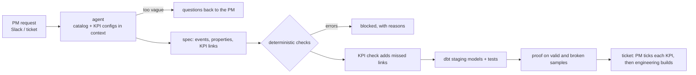

# spec-to-pipeline-agent

An LLM agent that turns a product manager's tracking request ("we're adding a Buy now
button, can we track it?") into an **event spec an engineer can build**. It lists the events,
a JSON Schema for each, and the existing KPIs the change could move. Then plain code checks
the spec, generates the dbt staging models and tests, and proves them on sample events
before anyone writes app code.

> Simulated customer: Harbor & Pine Outfitters is fictional. The 20 requests, the event
> catalog and the KPI configs in [`customer/`](customer/) are made up for this project.
> This is phase 3 of the engagement in
> [sql-to-dbt-migration-agent](https://github.com/artur115/sql-to-dbt-migration-agent) and
> [data-incident-triage-agent](https://github.com/artur115/data-incident-triage-agent).

It is modelled on a workflow I led in production: an LLM skill turned a PM's ticket or Slack
message into an event list and field schema, and checked it against the KPI configs. A ticket
went to engineering only after the PM confirmed it. The point was to stop a common failure:
events shipped without being tied to a KPI, then found months later and fixed with a large backfill.

## Results

| | Agent (Claude) |
|---|---:|
| Requests | 20 (3 deliberately too vague to spec) |
| Specs ready for engineering, all checks passing | *not run yet* |
| Vague requests answered with questions, not a guessed spec | *not run yet* |
| Required KPI links found by the agent | *not run yet* |
| …by the agent plus the config check | *not run yet* |
| Reused the catalog instead of re-creating events | *not run yet* |
| Captured personal data | *not run yet* (must be 0) |

The column is filled in by the first recorded run (`make record`). Until then it stays empty
rather than estimated. The labels it is scored against were written first:
[`evals/labels.yml`](evals/labels.yml).

What already runs without a model: the checks, the dbt generator and the pipeline proof,
exercised in CI on a hand-written reference spec. Its rendered ticket is
[`examples/REQ-020.ticket.md`](examples/REQ-020.ticket.md), and `dbt build` passes 13/13.

There is no "no-AI" baseline here, unlike the other two projects. Turning free text into a
spec has no sensible rule-based version. The deterministic part is the guardrail around the
model, and its value is measured directly: KPI recall with and without the config check.

## What it checks, and why

| Check | Why it matters | Where |
|---|---|---|
| Reuse before add: `new` on a catalog event is an error | Two events for one action split every KPI that reads them | `checks.py` |
| No type changes on existing properties | Breaks every downstream model and dashboard | `checks.py` |
| New properties on existing events are optional | Older app versions won't send them | `checks.py` |
| Extending an enum keeps the old values | Historical rows still carry them | `checks.py` |
| No personal data (email, phone, name, address) | Analytics events are not the place for it | `checks.py` |
| KPI configs read directly | Flags a KPI built on a touched event even if the model forgot it | `checks.py` |
| Valid JSON Schema (draft-07) per event | The contract the app and the pipeline share | `checks.py` |
| Generated dbt model + tests catch broken samples | Proves the pipeline before app code exists | `pipeline.py` |



## The 20 requests
They range from clear (REQ-020: "track each step of the new 3-step checkout") to traps:
- **REQ-016 "track BOPIS orders":** already tracked by `order_completed.fulfillment_method = pickup`. The right answer adds nothing new.
- **REQ-014 "notify me when back in stock":** the form takes an email address, and the spec must not capture it.
- **REQ-005, REQ-010, REQ-018:** too vague ("do people like the guides?", "make the dashboard better", "track everything"). The right answer is a question.

## Run it

```bash
pip install -r requirements.txt
make demo       # tests, reference spec through a real dbt build, agent replay
make record     # real agent run on all 20 requests; needs ANTHROPIC_API_KEY
```

The default is `claude-opus-5-5` at high effort (`SPEC_MODEL` / `SPEC_EFFORT` to change).
Each request writes `report/specs/<id>.md` (the ticket) and `.json` (spec, checks, proof, score).

## 2-minute walkthrough
1. `customer/requests/REQ-004.md`: "add curbside pickup next to ship and in-store pickup."
2. `examples/REQ-020.ticket.md`: what a PM sees: events, properties, KPI checkboxes, the pipeline proof.
3. `tests/test_spec_agent.py::test_checker_rescues_a_missed_kpi_link`: the agent forgets
   `store_pickup_adoption`; the config check adds it.
4. `spec_agent/pipeline.py`: broken samples (missing required field, value outside the enum) are caught.

---
Artur Kochetkov · [arturkochetkov.dev](https://arturkochetkov.dev) · MIT licence
